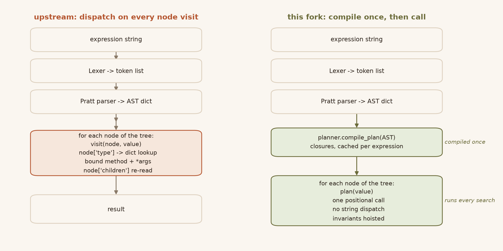
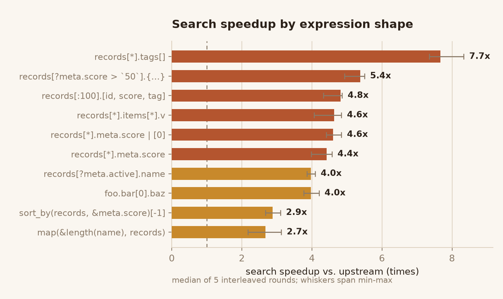
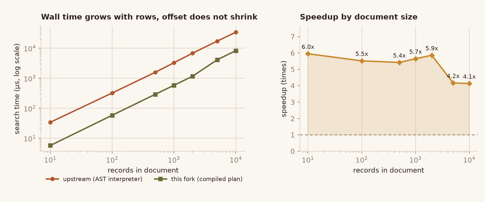
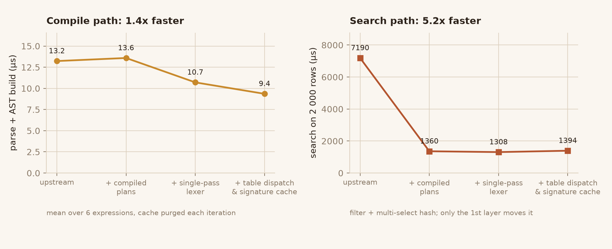

JMESPath
========

.. image:: https://badges.gitter.im/Join Chat.svg
   :target: https://gitter.im/jmespath/chat

.. image:: https://img.shields.io/badge/license-MIT-blue.svg
   :target: LICENSE

.. image:: https://img.shields.io/badge/python-3.9%20%7C%203.10%20%7C%203.11%20%7C%203.12%20%7C%203.13%20%7C%203.14-blue.svg

.. image:: https://img.shields.io/badge/search-4.4%C3%97%20faster-b4552f.svg

JMESPath (pronounced "james path") allows you to declaratively specify how to
extract elements from a JSON document.

For example, given this document::

    {"foo": {"bar": "baz"}}

The jmespath expression ``foo.bar`` will return "baz".

.. note::

   **This is a performance fork of jmespath.py.** The public API, the JMESPath
   language and every result are unchanged; only how an expression is
   *evaluated* changed. Searches are **2.7x-7.7x faster** (median **4.4x** over
   ten expression shapes) and parsing is **1.4x faster**, because a compiled
   expression now runs through closures instead of re-dispatching on the AST
   for every node visit. See `Performance`_ for the numbers and
   `OPTIMIZATION.md <OPTIMIZATION.md>`_ for the analysis.

JMESPath also supports:

Referencing elements in a list.  Given the data::

    {"foo": {"bar": ["one", "two"]}}

The expression: ``foo.bar[0]`` will return "one".
You can also reference all the items in a list using the ``*``
syntax::

   {"foo": {"bar": [{"name": "one"}, {"name": "two"}]}}

The expression: ``foo.bar[*].name`` will return ["one", "two"].
Negative indexing is also supported (-1 refers to the last element
in the list).  Given the data above, the expression
``foo.bar[-1].name`` will return "two".

The ``*`` can also be used for hash types::

   {"foo": {"bar": {"name": "one"}, "baz": {"name": "two"}}}

The expression: ``foo.*.name`` will return ["one", "two"].

Installation
============

You can install JMESPath from pypi with:

.. code:: bash

    pip install jmespath

To use this fork instead, install it from a checkout (there is no separate
package name on PyPI):

.. code:: bash

    git clone https://github.com/linluozi/jmespath-compiled-plans.git
    cd jmespath-compiled-plans
    pip install .

Requirements: **Python 3.9+** (tested on CPython 3.9-3.14, Windows/macOS/
Linux). No runtime dependencies; ``pytest`` is only needed for the test suite.
``pip install -r requirements.txt`` pulls the pinned test toolchain.

Quick start
===========

.. code:: python

    import jmespath

    data = {
        'records': [
            {'id': 1, 'name': 'alpha', 'meta': {'score': 91}},
            {'id': 2, 'name': 'beta',  'meta': {'score': 12}},
        ]
    }

    # One-shot: parse + evaluate.
    jmespath.search('records[?meta.score > `50`].name', data)
    # ['alpha']

    # Repeated use: compile once, search many times (this is where the
    # compiled plan pays off -- the AST is turned into closures on the first
    # search and reused afterwards).
    expression = jmespath.compile('records[?meta.score > `50`].{id: id, name: name}')
    for _ in range(1000):
        expression.search(data)

Nothing else changes: ``jmespath.compile(...).parsed`` still returns the AST
dict, ``Options`` still selects ``dict_cls``/``custom_functions``, and the
``TreeInterpreter`` is still available for code that walks ASTs itself.

API
===

The ``jmespath.py`` library has two functions
that operate on python data structures.  You can use ``search``
and give it the jmespath expression and the data:

.. code:: python

    >>> import jmespath
    >>> path = jmespath.search('foo.bar', {'foo': {'bar': 'baz'}})
    'baz'

Similar to the ``re`` module, you can use the ``compile`` function
to compile the JMESPath expression and use this parsed expression
to perform repeated searches:

.. code:: python

    >>> import jmespath
    >>> expression = jmespath.compile('foo.bar')
    >>> expression.search({'foo': {'bar': 'baz'}})
    'baz'
    >>> expression.search({'foo': {'bar': 'other'}})
    'other'

This is useful if you're going to use the same jmespath expression to
search multiple documents.  This avoids having to reparse the
JMESPath expression each time you search a new document.

Options
-------

You can provide an instance of ``jmespath.Options`` to control how
a JMESPath expression is evaluated.  The most common scenario for
using an ``Options`` instance is if you want to have ordered output
of your dict keys.  To do this you can use either of these options:

.. code:: python

    >>> import jmespath
    >>> jmespath.search('{a: a, b: b}',
    ...                 mydata,
    ...                 jmespath.Options(dict_cls=collections.OrderedDict))

    >>> import jmespath
    >>> parsed = jmespath.compile('{a: a, b: b}')
    >>> parsed.search(mydata,
    ...               jmespath.Options(dict_cls=collections.OrderedDict))

Custom Functions
~~~~~~~~~~~~~~~~

The JMESPath language has numerous
`built-in functions
<http://jmespath.org/specification.html#built-in-functions>`__, but it is
also possible to add your own custom functions.  Keep in mind that
custom function support in jmespath.py is experimental and the API may
change based on feedback.

**If you have a custom function that you've found useful, consider submitting
it to jmespath.site and propose that it be added to the JMESPath language.**
You can submit proposals
`here <https://github.com/jmespath/jmespath.site/issues>`__.

To create custom functions:

* Create a subclass of ``jmespath.functions.Functions``.
* Create a method with the name ``_func_<your function name>``.
* Apply the ``jmespath.functions.signature`` decorator that indicates
  the expected types of the function arguments.
* Provide an instance of your subclass in a ``jmespath.Options`` object.

Below are a few examples:

.. code:: python

    import jmespath
    from jmespath import functions

    # 1. Create a subclass of functions.Functions.
    #    The function.Functions base class has logic
    #    that introspects all of its methods and automatically
    #    registers your custom functions in its function table.
    class CustomFunctions(functions.Functions):

        # 2 and 3.  Create a function that starts with _func_
        # and decorate it with @signature which indicates its
        # expected types.
        # In this example, we're creating a jmespath function
        # called "unique_letters" that accepts a single argument
        # with an expected type "string".
        @functions.signature({'types': ['string']})
        def _func_unique_letters(self, s):
            # Given a string s, return a sorted
            # string of unique letters: 'ccbbadd' ->  'abcd'
            return ''.join(sorted(set(s)))

        # Here's another example.  This is creating
        # a jmespath function called "my_add" that expects
        # two arguments, both of which should be of type number.
        @functions.signature({'types': ['number']}, {'types': ['number']})
        def _func_my_add(self, x, y):
            return x + y

    # 4. Provide an instance of your subclass in a Options object.
    options = jmespath.Options(custom_functions=CustomFunctions())

    # Provide this value to jmespath.search:
    # This will print 3
    print(
        jmespath.search(
            'my_add(`1`, `2`)', {}, options=options)
    )

    # This will print "abcd"
    print(
        jmespath.search(
            'foo.bar | unique_letters(@)',
            {'foo': {'bar': 'ccbbadd'}},
            options=options)
    )

Again, if you come up with useful functions that you think make
sense in the JMESPath language (and make sense to implement in all
JMESPath libraries, not just python), please let us know at
`jmespath.site <https://github.com/jmespath/jmespath.site/issues>`__.

Performance
===========

What changed
------------

Upstream evaluates an expression by walking the AST and, **for every node
visit**, looking the handler up by string::

    def visit(self, node, *args, **kwargs):
        method = self._method_cache.get(node['type'])   # dict lookup, per node
        return method(node, *args, **kwargs)            # *args tuple, per node

For a filter over 2 000 records that is tens of thousands of dictionary
lookups, bound-method calls and ``node[...]`` subscripts -- all of it
repeated for an AST that never changes between searches.

This fork compiles the AST **once** into a graph of closures
(``jmespath/planner.py``).  A search then becomes a chain of plain
one-argument calls.  Structural facts that only depend on the expression are
resolved at build time: constant literals, the dict type for multi-select
hashes, function arity, slice objects, and "is the projection body just a
field access" (which gets inlined into the loop).

Results
-------

Search time on a 2 000-record document, upstream vs. this fork. Values are the
median of per-round ratios over five interleaved rounds; whiskers span the
observed min-max across three independent runs of the whole benchmark.

============  =================================  ========  =========
Case          Expression                         Upstream  This fork
============  =================================  ========  =========
flatten       ``records[*].tags[]``              2 114 us  **7.7x**
filter_hash   ``records[?meta.score > 50]``      6 637 us  **5.4x**
multi_select  ``records[:100].[id, score]``      197 us    **4.8x**
nested_proj   ``records[*].items[*].v``          3 566 us  **4.6x**
pipe_index    ``records[*].meta.score | [0]``    1 514 us  **4.6x**
field_proj    ``records[*].meta.score``          1 538 us  **4.4x**
small_select  ``foo.bar[0].baz``                 3.6 us    **4.0x**
filter_plain  ``records[?meta.active].name``     2 107 us  **4.0x**
sort_by       ``sort_by(records, &meta.score)``  2 200 us  **2.9x**
functions     ``map(&length(name), records)``    3 559 us  **2.7x**
============  =================================  ========  =========

Median across the ten shapes: **4.4x**.  The two slowest cases are the ones
that spend most of their time inside ``sorted()``/``map()`` callbacks, i.e. in
user-visible work rather than in the evaluator, so there is less dispatch left
to remove.

The gain does not depend on document size -- it is a constant factor, which is
what you expect from removing per-node overhead:

Compiling is also cheaper than before (a single-pass lexer and table-driven
parser dispatch).  The first layer below is the one that moves the search
path; the others move the compile path:

Memory is unchanged: peak traced allocation for ``compile`` + one search is
181 KiB here vs. 181 KiB upstream. The closure graph costs roughly 3.2 us of
build time per expression, paid once and cached next to the parsed expression.
The one-shot path ``jmespath.search(expr, data)`` (cold parser cache, cold
plan, one search) drops from 8.3 ms to 2.4 ms on the 2 000-row document.

Reproducing
-----------

Every number above comes from the scripts in ``bench/``:

.. code:: bash

    pip install -r requirements.txt
    git clone --depth 1 https://github.com/jmespath/jmespath.py ../upstream

    python bench/bench_compare.py --baseline ../upstream --optimized .
    python bench/bench_scale.py   --baseline ../upstream --optimized .
    python bench/bench_ablation.py --root .. --baseline upstream
    python bench/make_figures.py        # needs matplotlib

Each measurement runs in a fresh process and interleaves rounds, because a
laptop drifts: comparing two absolute medians taken minutes apart overstates
or understates the effect by 20-40%.  ``bench_ablation.py`` prints its own
noise floor by measuring two byte-identical checkouts.

Correctness
-----------

Speed means nothing if results move, so equivalence is enforced from two
directions:

* ``tests/compliance`` (the shared cross-implementation corpus) is run through
  both the compiled plan and the original interpreter and compared case by
  case -- see ``tests/test_planner_equivalence.py``;
* ``bench/fuzz_diff.py`` generates thousands of random expressions (valid and
  broken) and compares token streams, ASTs, results and exception types
  between an upstream checkout and this one::

      python bench/fuzz_diff.py ../upstream . 6000
      # compared 6000 expressions, 0 mismatches

The 991 upstream tests still pass unmodified.

Specification
=============

If you'd like to learn more about the JMESPath language, you can check out
the `JMESPath tutorial <http://jmespath.org/tutorial.html>`__.  Also check
out the `JMESPath examples page <http://jmespath.org/examples.html>`__ for
examples of more complex jmespath queries.

The grammar is specified using ABNF, as described in
`RFC4234 <http://www.ietf.org/rfc/rfc4234.txt>`_.
You can find the most up to date
`grammar for JMESPath here <http://jmespath.org/specification.html#grammar>`__.

You can read the full
`JMESPath specification here <http://jmespath.org/specification.html>`__.

Testing
=======

In addition to the unit tests for the jmespath modules,
there is a ``tests/compliance`` directory that contains
.json files with test cases.  This allows other implementations
to verify they are producing the correct output.  Each json
file is grouped by feature.

.. code:: bash

    python -m pytest tests            # 1342 tests: upstream suite + equivalence
    python -m pytest tests -q -k plan # only the plan-vs-interpreter checks

``tests/test_planner_equivalence.py`` is the safety net for the evaluator:
every compliance case, a parametrised matrix of awkward operands
(``0 == false``, ``bool`` vs ``int`` ordering, nested empties) and 600
randomly generated ASTs are evaluated through both engines and compared.

Project layout
==============

::

    jmespath/planner.py   compiled evaluation plans (new)
    jmespath/parser.py    ParsedResult caches a plan per Options shape
    jmespath/lexer.py     single-pass scanner (same tokens, same offsets)
    jmespath/functions.py pre-resolved function signatures
    jmespath/visitor.py   unchanged; still the reference implementation
    bench/                benchmarks, differential fuzzer, figure generator
    assets/               figures referenced by this README
    OPTIMIZATION.md       analysis, change list, measurement caveats

Discuss
=======

Join us on our `Gitter channel <https://gitter.im/jmespath/chat>`__
if you want to chat or if you have any questions.
